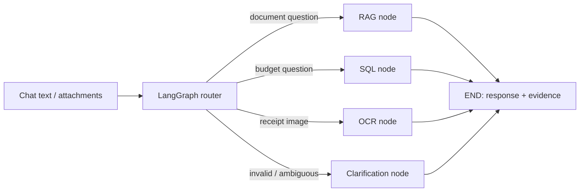

# Unify — Task 12 Unified AI Platform

A portable completion of Task 11: one Streamlit conversation routes document questions, budget questions and receipt images through **LangGraph**. There are no RAG/SQL/OCR selection buttons.

## Quick start (Windows PowerShell)

Prerequisites: **Python 3.13**, internet for the initial package installation, and **Tesseract OCR 5.x**. The tested Python version is recorded in `docs/VALIDATION.md`.

1. Open a terminal in this folder (the folder containing `app.py`).
2. Create a virtual environment and install dependencies:

   ```powershell
   py -3.13 -m venv .venv
   .\.venv\Scripts\python.exe -m pip install --upgrade pip
   .\.venv\Scripts\python.exe -m pip install -r requirements.txt
   ```

   No environment activation is required. Use Python 3.13 for the tested dependency set.

3. Install Tesseract if needed:

   ```powershell
   winget install --id UB-Mannheim.TesseractOCR --exact
   ```

   Alternatively use the Windows installer linked by the [Tesseract installation documentation](https://tesseract-ocr.github.io/tessdoc/Installation.html). The app discovers `C:\Program Files\Tesseract-OCR\tesseract.exe` automatically, or finds `tesseract` on PATH. A custom location can be set with `TESSERACT_CMD` in your local `.env`.

4. Start the app:

   ```powershell
   .\.venv\Scripts\python.exe -m streamlit run app.py
   ```

5. Open **http://localhost:8501**. Keep “Use bundled policy document” checked for the examples below. Ask questions in the bottom chat bar. Use the paperclip in that same input to attach files, then send the message.

**No API key or `.env` is needed for the local demo.** Local document answers are explicitly labelled retrieved excerpts, not model-generated prose. SQL uses a constrained natural-language planner. OCR uses the actual Tesseract engine. Every mode runs through the same LangGraph.

For the complete tested Windows dependency set, install `requirements-lock-windows.txt` instead of `requirements.txt`. The main requirements file pins direct dependencies; the Windows lock also pins their dependencies.

### macOS / Ubuntu

```bash
python3 -m venv .venv
.venv/bin/python -m pip install -r requirements.txt
# macOS: brew install tesseract
# Ubuntu: sudo apt-get install tesseract-ocr
.venv/bin/python -m streamlit run app.py
```

## Six required demo examples

These are real input/output checks, not just routing-label checks. Run them in the same conversation. Receipt uploads take priority over accompanying text. Upload documents and receipts in separate messages.

| # | Input | Expected graph path | Expected result |
|---|---|---|---|
| 1 | What is the annual leave policy? | router → rag | 24 days per calendar year; request five working days ahead; source citation |
| 2 | How many days per week may employees work remotely? | router → rag | Up to three days per week with manager approval |
| 3 | What is the allocated budget for Marketing in Q2 2025? | router → sql | INR 100,000 |
| 4 | Which departments overspent in Q2 2025? | router → sql | Engineering 30,000; Marketing 20,000; Operations 10,000 INR |
| 5 | Attach `samples/receipts/01_cafe.png`; send “Extract this receipt” | router → ocr | NORTHSTAR CAFE; 2026-06-15; total INR 525; tax 25; 3 items, 2 lines |
| 6 | Attach `samples/receipts/02_stationery.png`; send “Extract this receipt” | router → ocr | PAPER TRAIL; 2026-06-16; total INR 294; tax 14; 5 items, 2 lines |

Third clear receipt: `03_grocery.png` → GREEN BASKET, total INR 420, tax 20, 5 items across 3 lines. Synthetic samples are clearly marked and are not valid invoices.

For your PDF, attach `samples/ai_lecture_notes.pdf` with a question about the lecture content. Documents persist for subsequent questions in the current browser session. Uncheck the bundled policy document if you want to search only your uploaded documents. “Clear conversation” resets uploaded documents and chat history.

The app does not carry implicit pronouns across messages: ask self-contained questions such as “What is Marketing's allocation in Q2 2025?” Reattach the receipt for another extraction.

## Tests

From the project folder:

```powershell
.\.venv\Scripts\python.exe -m pytest -q
```

This includes real OCR integration tests, graph routing and answer assertions, Streamlit chat tests, missing-document and invalid-input errors, unknown-route handling, missing API keys, unreadable images/PDFs, and SQL read-only enforcement. Tesseract must be installed for the full test suite. To run the non-OCR subset during setup:

```powershell
.\.venv\Scripts\python.exe -m pytest -q -m "not ocr"
```

The screenshots in `docs/screenshots/` show actual app runs. See `docs/VALIDATION.md` for what was and was not tested, and `docs/DEMO.md` for a repeatable presentation script.

## Optional Hugging Face model backend

The original project used Hugging Face for document generation. This option is retained for generated RAG answers and broader natural-language SQL planning. It is optional and may incur provider charges. Check model availability and your account's inference permissions.

```powershell
Copy-Item .env.example .env
```

Edit only your local `.env`:

```dotenv
AI_BACKEND=huggingface
HUGGINGFACEHUB_API_TOKEN=your_actual_token
HF_LLM_MODEL=Qwen/Qwen2.5-7B-Instruct
```

Restart Streamlit. Choose a chat model supported by your inference provider if the example model is unavailable. In this mode document excerpts/questions and budget questions/schema go to Hugging Face; receipt OCR stays local. The router remains deterministic. Missing keys or provider failures produce actionable errors rather than quietly pretending generation succeeded. Live hosted inference requires your own account and is not part of the offline acceptance tests.

**Never submit `.env`, real keys, local caches, or secrets.** This package contains only `.env.example`; `.gitignore` excludes private environment files. There are no imports from the old Task 5/7/8 folders and no absolute user-specific project paths.

## Architecture and LangGraph basics



`StateGraph` defines shared request state: the question, attachments, documents, route, response and execution trace. **Nodes** are Python functions that return state updates. **Edges** connect nodes. A **conditional edge** after the supervisor selects RAG, SQL, OCR or clarification. Each capability node then reaches `END`. Streamlit calls only `workflow().invoke(...)`.

A normal LangChain sequence usually passes one step's output into the next in a fixed order. LangGraph makes shared state and branching explicit and also supports loops, checkpointing and human intervention when needed. LangChain itself can also branch; the distinction is not that chains are incapable of routing. This project uses a single supervised graph without loops/checkpoint persistence. Browser-session chat history is separate from graph state. See [LangGraph Graph API](https://docs.langchain.com/oss/python/langgraph/graph-api) and [conditional edges](https://docs.langchain.com/oss/python/langgraph/use-graph-api).

### Routing policy

1. Validate file types, file count, size and question.
2. Mixed image/document messages request clarification.
3. An image routes to OCR, even if the accompanying text mentions budgets.
4. Receipt-specific text routes to OCR; without an image it asks for one.
5. An attached document or policy/document wording routes to RAG.
6. Department/budget/spending wording routes to SQL.
7. Ambiguous terms such as “the total” request clarification.
8. Other question forms search the loaded documents; unrelated evidence produces an abstention.

Rules use word boundaries rather than broad substring matches. Unknown router labels go to clarification. Rule-based routing is repeatable but not a general semantic classifier; mixed or unclear requests may need rephrasing. Tests demonstrate supported cases, not universal correctness for arbitrary language.

### Capability details and limits

- **RAG:** PDF/TXT extraction, overlapping chunks, TF-IDF retrieval with source/page/chunk citations. Local mode displays excerpts; optional HF generates an answer grounded in those excerpts. Scanned/encrypted PDFs are rejected. Maximum 10 MB per upload and 300 PDF pages. Uploaded content is data, not trusted instructions.
- **SQL:** fixed CSV loaded into an in-memory SQLite database; local planner supports allocation, spending totals, departmental overspend, averages and sorted listings. One explicit year/quarter is supported locally; “this quarter” uses the machine's current date. Missing time filters mean all available periods. Optional HF produces a SELECT proposal. Both paths use SQLite query-only mode, table/function authorizer restrictions, a query execution budget and 200-row display limit. Results include the SQL and bound parameters. Unsupported language may need rephrasing; this is a constrained agent/tool workflow.
- **OCR:** real Tesseract, image orientation/grayscale/resize preprocessing, structured vendor/date/currency/subtotal/tax/total/items and quantity extraction, raw text and reconciliation warnings. Count of parsed lines is separate from total item quantity. Missing fields remain null, not guessed. The parser is strongest on clear quantity/unit/amount layouts; arbitrary receipts can need review. Dates remain as printed to avoid ambiguous day/month conversion.
- **Operational scope:** demo-ready local application, not a multi-user hosted production service. No authentication or durable conversation storage. Uploaded documents are processed in memory; a bounded process-local extraction cache lasts until restart. Do not deploy publicly with sensitive files without adding access control and appropriate data retention.

## Sample data and original-project audit

`samples/company_policy.txt` is a fictional, sufficiently detailed policy sample. `samples/ai_lecture_notes.pdf` is your supplied PDF, copied unchanged. `samples/budget.csv` is deterministic synthetic INR budget data (48 rows, six departments, two years). `samples/receipts/` contains three generated clear receipts with expected values; `samples/user_receipts/` retains your three supplied images unchanged.

The supplied `Loan_default.csv.xlsx` contains borrower/loan/default columns, not departments, allocated budgets or actual spending. It is therefore **not relabelled as a budget dataset** and is not needed in the runnable submission. Its original stays untouched. Your Swiss receipt is useful for inclusive tax; the Walmart image lacks a visible date; `r9.png` has three 30.00 item amounts but a printed total of 60.00, with no tax shown. These are exploratory edge cases, not exact OCR acceptance fixtures.

The original Task_11 had a direct `if/elif` router rather than a LangGraph, imported receipt helpers from another local folder, relied on external SQL code, lacked a standalone budget dataset, and tested routing labels rather than actual capability results. This version replaces that wiring with explicit graph nodes, portable modules, deterministic data, a single chat interface, safe errors and executable integration tests. The original folder and its private `.env` have not been modified or copied.

## Project layout

```text
app.py                     Streamlit chat; no capability selection
platform_core/graph.py     StateGraph, supervisor, conditional edges
platform_core/rag.py       document extraction / retrieval / generation
platform_core/budget.py    query planning and guarded SQLite execution
platform_core/ocr.py       real OCR and receipt parsing
platform_core/llm.py       optional model client and credential errors
samples/                   policy, lecture PDF, budget, receipt images
tests/                     graph, output, error and UI tests
scripts/generate_samples.py reproducible synthetic fixtures
docs/                      validation, demo script, real screenshots
requirements.txt           tested dependency pins
.env.example               placeholders only
```

## Troubleshooting

| Symptom | Action |
|---|---|
| No document uploaded | Enable sample document or attach PDF/TXT with a question |
| Invalid question / unclear route | Ask a full question naming document topic, receipt or budget |
| OCR missing / failed | Install Tesseract, set custom path if needed, use a sharp PNG/JPEG |
| No parsed items / missing fields | Check raw OCR text and original image; use clear samples for acceptance |
| Missing API key | Use `AI_BACKEND=local`, or configure your own HF token and restart |
| No budget rows | Specify Q2 2025; sample contains only 2025–2026 |
| PDF has no readable text | Use a text-based PDF or UTF-8 TXT; scanned PDF OCR is not implemented |
| Port 8501 busy | Add `--server.port 8502` to the run command and open that port |

To regenerate synthetic files, run `python scripts/generate_samples.py` inside the configured environment. This overwrites only the fictional budget/receipt fixtures, not user-supplied files.
