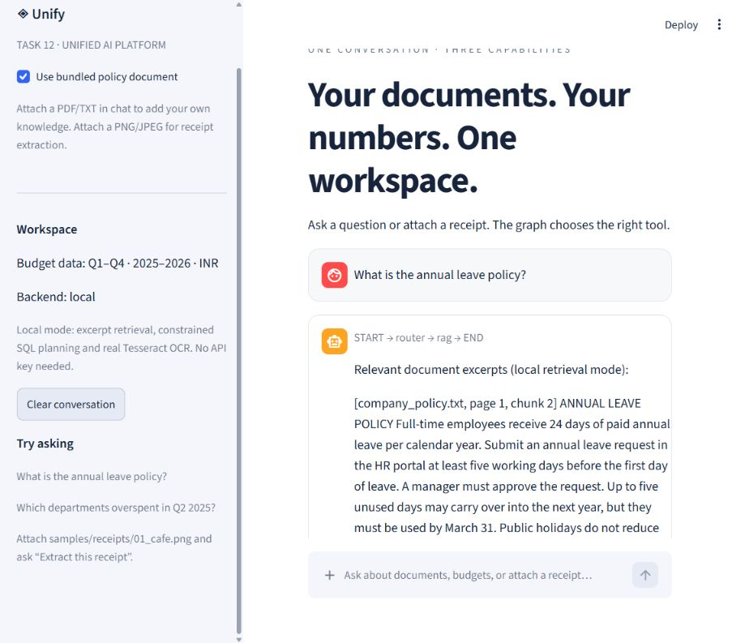
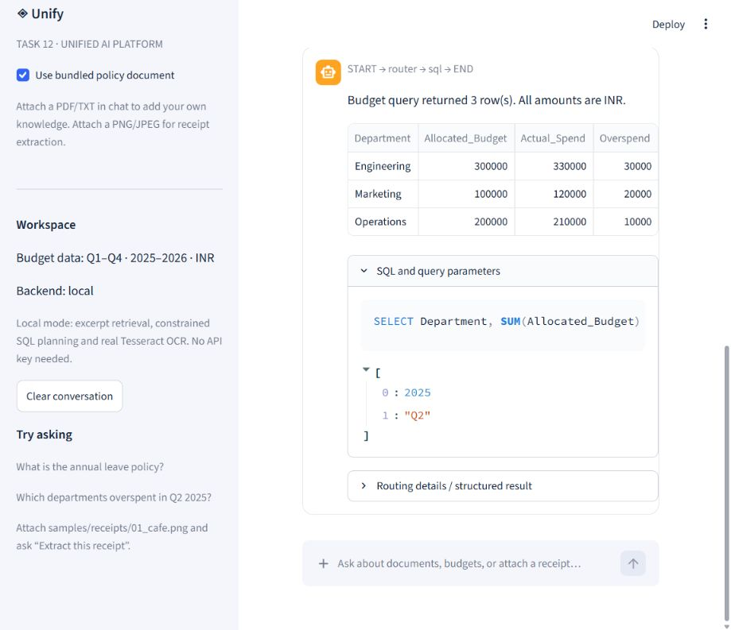
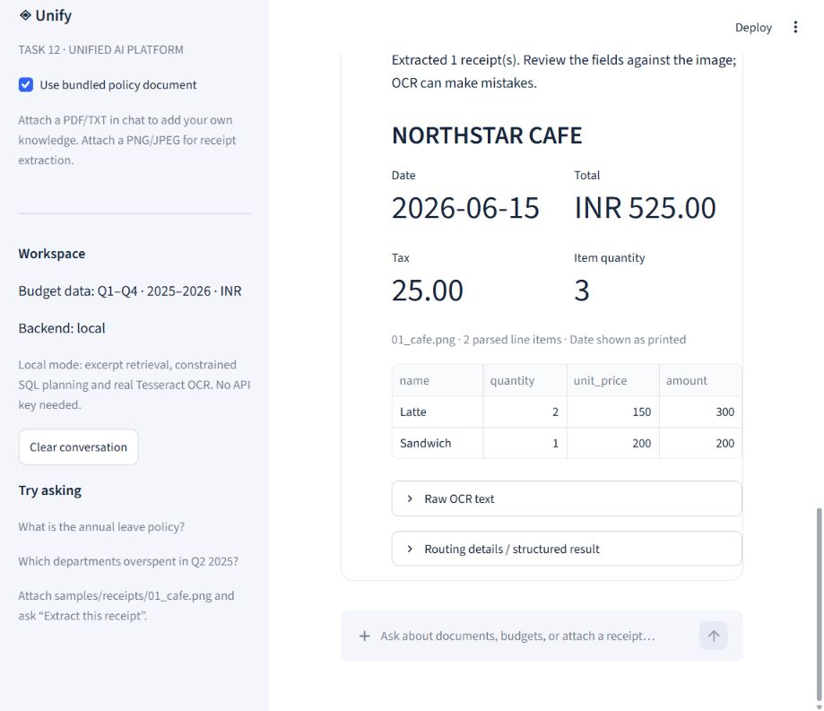

# Working application captures

These screenshots were captured from the real Streamlit app during browser verification on 2026-09-16. The same conversation switched between RAG, SQL and OCR without selecting an agent.

## Document question

## Budget question

## Receipt upload

The receipt results use two columns so dates and totals remain readable in the narrow browser viewport. See `../VALIDATION.md` for the scope and limitations of testing.
